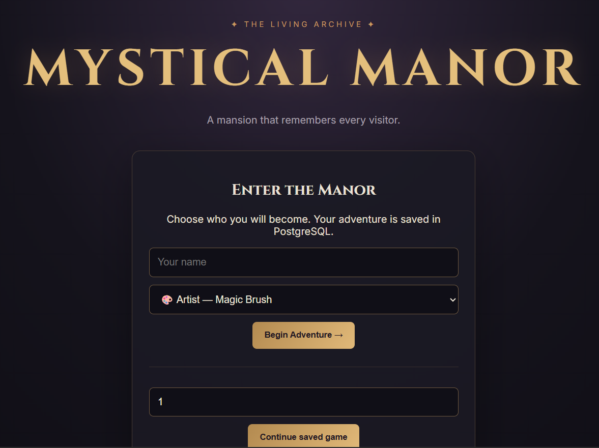
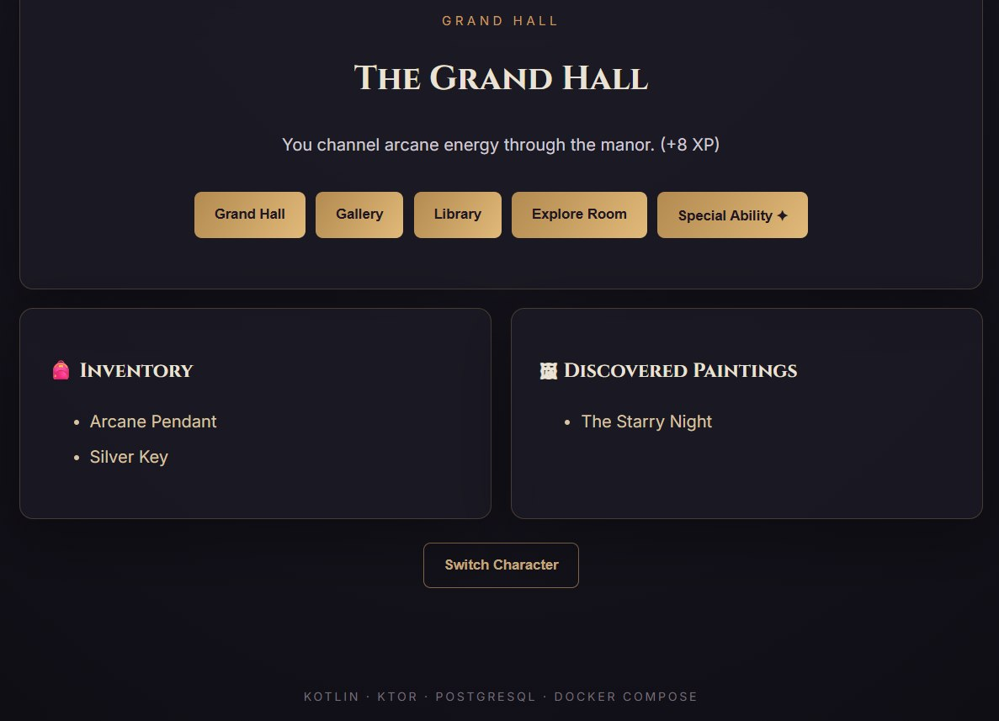
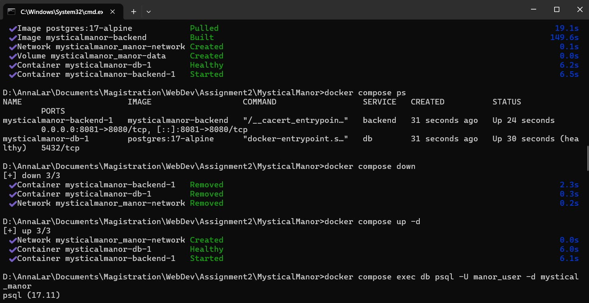
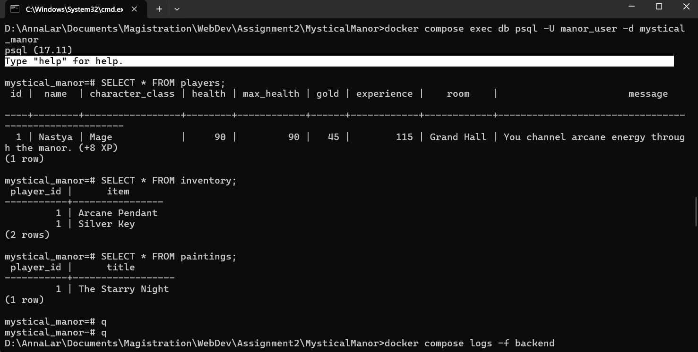
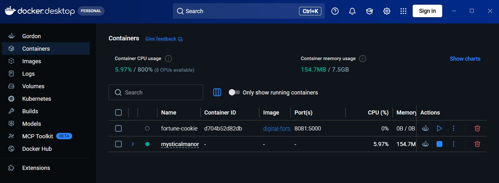

<div align="center">

# 🏰 MYSTICAL MANOR
### The Living Archive

**A Kotlin adventure game with a persistent world, a web interface, and a multi-container architecture.**

*Enter the manor. Discover its secrets. Your progress survives.*

</div>

---

## ✦ About the project

I extended my original **Mystical Manor Adventure**, a Kotlin console game, into a small web application backed by PostgreSQL. The original console-game classes are preserved; the web edition adds a separate Ktor server, a browser interface, and database-backed gameplay.

Players can choose **Artist**, **Explorer**, or **Mage**, explore the Grand Hall, Gallery, and Library, collect items, discover paintings, and use class-specific abilities. Player state is stored in a relational database instead of disappearing when the application restarts.

## ✦ Game preview

| Create your character | Explore the manor |
|:---:|:---:|
|  |  |  |

> Screenshots are captured from the running application. See `screenshots/` for all evidence.

## ✦ Architecture

```text
Browser (HTML / CSS / JavaScript)
            │ HTTP :8081
            ▼
   Kotlin / Ktor backend  ──── SQL ────► PostgreSQL
       Docker service: backend           Docker service: db
            │                                  │
            └──── Docker Compose network ─────┘
                                               │
                                      Named volume: manor-data
```

Docker Compose starts **two services**. The backend is built from a custom `Dockerfile`; PostgreSQL uses the `postgres:17-alpine` image. The backend connects to the database using the Compose service name `db`, not `localhost`. A database health check helps ensure PostgreSQL is ready before the backend starts.

## ✦ Getting started

**Requirements:** Docker Desktop with Docker Compose, and an available host port (default `8081`). You do not need to install Kotlin, Gradle, or PostgreSQL locally.

**1. Clone the repository**

```bash
git clone https://github.com/YOUR-USERNAME/mystical-manor-docker-compose.git
cd mystical-manor-docker-compose
```

**2. Create your local environment file**

Windows CMD:

```cmd
copy .env.example .env
```

macOS / Linux:

```bash
cp .env.example .env
```

Edit `.env` and replace the placeholder password with your own local password:

```dotenv
APP_PORT=8081
POSTGRES_DB=mystical_manor
POSTGRES_USER=manor_user
POSTGRES_PASSWORD=REPLACE_WITH_YOUR_OWN_PASSWORD
```

**Never commit `.env` or real credentials.** Only `.env.example` belongs in the repository.

**3. Build and start both services**

```bash
docker compose up --build -d
```

**4. Check their status**

```bash
docker compose ps
```

**5. Open the application**

- Game: **http://localhost:8081/**
- API health: **http://localhost:8081/api/health**

If `8081` is occupied, change `APP_PORT` in `.env` (for example, to `8082`) and recreate the backend with `docker compose up -d`.

## ✦ Docker evidence

### 1. Successful image build



### 2. Running backend and database containers



### 3. Both services in Docker Desktop



## ✦ REST API

| Method | Endpoint | Purpose |
|---|---|---|
| `GET` | `/api/health` | Backend health check |
| `POST` | `/api/players` | Create a character and save it in PostgreSQL |
| `GET` | `/api/players/{id}` | Load saved player progress |
| `POST` | `/api/players/{id}/actions` | Explore, move, or use an ability; persist changes |
| `GET` | `/api/players/{id}/inventory` | Read saved inventory |
| `GET` | `/api/players/{id}/paintings` | Read discovered paintings |

Example requests (replace `1` with your saved player ID):

```bash
curl http://localhost:8081/api/health
curl http://localhost:8081/api/players/1
curl http://localhost:8081/api/players/1/paintings
```

## ✦ PostgreSQL and persistence

The database contains three related tables:

| Table | Stored data |
|---|---|
| `players` | Name, class, HP, gold, experience, current room, last event |
| `inventory` | Items linked to each player |
| `paintings` | Paintings discovered by each player |

The backend uses SQL **INSERT**, **SELECT**, and **UPDATE** statements. The `inventory` and `paintings` tables reference `players` using foreign keys.

To inspect the database using the credentials from `.env`, run:

```bash
docker compose exec db psql -U manor_user -d mystical_manor
```

Then:

```sql
SELECT id, name, character_class, health, gold, experience, room FROM players;
SELECT * FROM inventory;
SELECT * FROM paintings;
```

Type `\q` to exit `psql`.

### Persistence demonstration

1. Create a player and explore the manor.
2. Note the player's save ID and discovered items or paintings.
3. Remove and recreate the containers:

```bash
docker compose down
docker compose up -d
```

4. Reload the saved player in the browser. The progress is still present because PostgreSQL stores its data in the **`manor-data` named volume**.

> **Important:** `docker compose down -v` removes named volumes and can permanently delete the saved database. Do not use it for the persistence demonstration.

## ✦ Project structure

```text
MysticalManor/
├── src/main/kotlin/
│   ├── Main.kt                 # Original console entry point
│   ├── Game.kt                 # Original console gameplay
│   ├── Character.kt            # Character classes
│   ├── WebMain.kt              # Ktor API + PostgreSQL persistence
│   └── ...                     # Original game models
├── src/main/resources/web/
│   ├── index.html              # Browser UI
│   ├── style.css               # Manor theme
│   └── script.js               # API calls and rendering
├── screenshots/                # Build, database, API, UI evidence
├── gradle/wrapper/             # Gradle wrapper files
├── gradlew
├── gradlew.bat
├── build.gradle.kts
├── settings.gradle.kts
├── Dockerfile
├── compose.yaml
├── .dockerignore
├── .gitignore
├── .env.example
└── README.md
```

## ✦ Docker configuration

- **Custom backend Dockerfile:** packages the Kotlin/Ktor application.
- **Compose services:** `backend` and `db`.
- **Port mapping:** host `${APP_PORT:-8081}` → backend `8080`.
- **Internal networking:** backend connects to PostgreSQL using hostname `db` and port `5432`.
- **Environment variables:** database name, user, password, and application port.
- **Secrets:** real credentials are kept in a local, Git-ignored `.env` file.
- **Named volume:** `manor-data` persists database files.
- **Health check and dependency:** backend waits for the database health check.
- **Ignore files:** `.gitignore` and `.dockerignore` exclude local and unnecessary files.

## ✦ Useful commands

| Command | Description |
|---|---|
| `docker compose up --build -d` | Build and start the application |
| `docker compose ps` | Show both services and their status |
| `docker compose logs -f backend` | Follow backend logs |
| `docker compose logs -f db` | Follow PostgreSQL logs |
| `docker compose down` | Stop/remove containers while keeping saved data |
| `docker compose up -d` | Recreate services using existing images |
| `docker compose config -q` | Validate Compose configuration |

